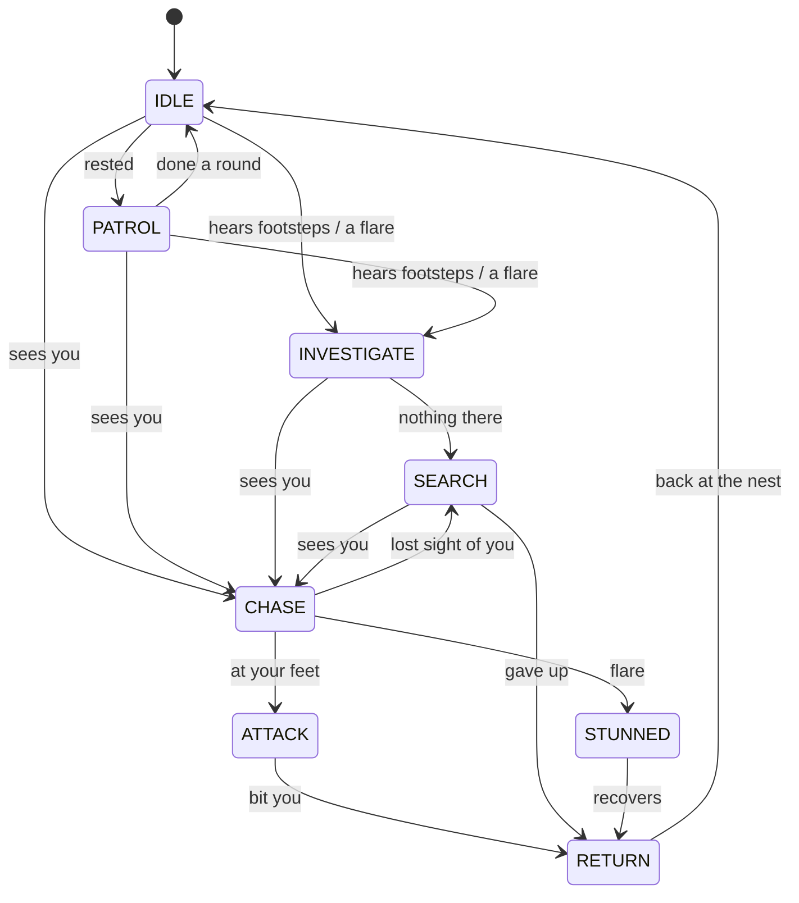
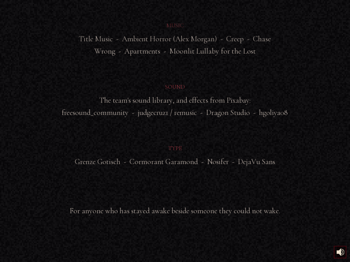

<p align="center">
  
</p>

<h1 align="center">The Crimson Sleep</h1>

<p align="center"><i>some dreams don't let you wake up</i></p>

<p align="center">
A 2D pixel-art horror escape in <b>C++17 + SFML 3</b> where every mechanic runs on a
<b>hand-written data structure</b>, and you can watch those structures change live while you play.
</p>

---

On **June 26, 1953** ten people were murdered in a mansion. Since then the house has slept in crimson.
You wake on its floor. Find the keys, read the clues and survive the dead: Samara, Carrie, the
spirits, the Weavers and the Devil. Then choose how the nightmare ends.

**Highlights**

- **Ten rooms** joined in a **graph**, with locked doors, a hidden passage found by **DFS**, and a **BFS** hint route plus a trail of blood to your goal.
- **Enemy AI** with an **eight-state machine**, **line of sight**, **sound detection**, and **A\*** and **BFS** pathfinding.
- **Stealth**: turn your lantern off, stand still, or hide in a wardrobe. Or **stomp** a spider flat when it rears up at your feet (short reach, 12 s cooldown).
- **Doors you walk through**: a door swings open on its hinge, the hero walks through, and it shuts behind you with a thud. Locked doors rattle.
- **A boss fight**: the hero draws the Blessed Sword (animated swing in four directions) and needs six blows to end the Devil, who answers with his **scythe**: a telegraphed swing you **block (C)**, step out of, or break with a flare. A scythe hit cuts you (health down, fear up). When he falls, he bursts into ash and ten freed souls rise.
- **Samara's locket**: take it from her bones and she rises beside them. Give it back (E) and she turns to light; only then can you reach the true ending.
- **Save & continue**, health kits hidden in drawers, and rolling **credits** over TV static.
- **Live data-structure console**: press **TAB** and the window widens with a panel that draws every structure as the game changes it.
- **Watch the dream**: a self-playing demo that finishes the whole game, with the console open beside it.
- **No STL.** No `std::vector`, `std::string`, `std::map`, `std::queue` or `<algorithm>`: stack, queue, heap, list, tree, graph, grid and even the string class are all written by hand in [`src/ds/`](src/ds).
- **Four endings**, survival notes that slide in at the side without pausing the game, a fear system, jump scares and a mini-map.

---

## Contents
1. [See it](#see-it)
2. [The data structures](#the-data-structures)
3. [Enemy AI: how the Weavers hunt](#enemy-ai-how-the-weavers-hunt)
4. [Watch the dream (demo mode)](#watch-the-dream-demo-mode)
5. [The house](#the-house)
6. [Horrors, and how to survive them](#horrors-and-how-to-survive-them)
7. [Menus, saving and credits](#menus-saving-and-credits)
8. [Endings](#endings)
9. [Controls](#controls)
10. [Build & run](#build--run)
11. [Project layout & tools](#project-layout--tools)
12. [Credits](#credits)

---

## See it

<p align="center">
  <br>
  <sub>The Library with the console open (TAB). A Weaver has <b>seen</b> the player: its state machine shows <code>CHASE</code>, and its <b>A*</b> path is drawn as red dots on the floor.</sub>
</p>

| | |
|---|---|
| <br><sub>Stuck for 30 s? The hint names the goal and the <b>BFS</b> route to it.</sub> | <br><sub>Samara hunts by sound. Stand still and she loses your trail.</sub> |
| <br><sub>The Collapsed Bedroom: pits, fire, spikes and a lever.</sub> | <br><sub>The Crimson Crypt: the Devil winds up his scythe, and the floor he is about to cut glows red. His health bar sits at the bottom.</sub> |
| <br><sub>Meet a horror and a survival note slides in at the side. The game keeps running.</sub> | <br><sub>Doors swing open on their hinge and the hero walks through.</sub> |
| <br><sub>Give Samara back her locket and she turns to light.</sub> | <br><sub>Six blows: the Devil convulses, cracks of light split out of him, then he bursts into ash.</sub> |
| <br><sub>Hiding in a wardrobe: nothing can see, hear or touch you.</sub> | <br><sub>A spider at your feet: the ring shows the stomp's reach.</sub> |

---

## The data structures

Every structure lives in [`src/ds/`](src/ds). They are header-only and independent of SFML, and each one is
unit-tested by `make test`. Each one does a real job in the game: take it away and a mechanic breaks.


**Live console (TAB).** Click a card to open it and see *every* element (the whole stack, every queued scare, every threat, the whole inventory list, the full route); click again to fold it. Press TAB in-game and the window widens: the game keeps its full view on the
left and a console strip opens on the right. Each card *draws* its structure from the live game
state, so you can watch keys move through the linked list, rooms stack up as you walk, and the
threat heap reorder as something closes in. The *Dangers* card lists the two worst threats in true
order by popping a **copy** of the heap (the raw heap array is only partly sorted, so slot 1 is not
always the runner-up). TAB or the graph icon (bottom-right) closes it again.
In fullscreen the game is letterboxed and the console takes the right-hand strip.

| Structure | File | What it does in the game |
|---|---|---|
| **Graph** (adjacency list) | [`ds/Graph.h`](src/ds/Graph.h), [`world.cpp`](src/world.cpp) | **The house.** Rooms are nodes and doors are edges. Each edge stores its door number, whether it's locked, the item that opens it, and a *hidden* flag for secret passages. Every door you use goes through the graph. |
| **Stack** | [`ds/Stack.h`](src/ds/Stack.h) | **Where you've been.** Entering a room pushes it. **B** pops the current room and takes you back through the door to the previous one. |
| **Queue** | [`ds/Queue.h`](src/ds/Queue.h) | **The haunting timeline.** Each room schedules its scares (whispers, door slams, cracking floors, blood writing) and they fire first-in, first-out. Queues are also the frontier of every BFS. |
| **Priority Queue** (max-heap) | [`ds/PriorityQueue.h`](src/ds/PriorityQueue.h) | **Danger right now.** Every frame each threat is inserted with a priority, from Samara's attack (100) and the Devil (90) down to "something heard your footsteps" (45), darkness (20) and calm (0). The top one drives the warning text, the fear rate and the chase music. It is also the open set of **A\***. |
| **Linked List** | [`ds/LinkedList.h`](src/ds/LinkedList.h) | **Inventory.** Items are inserted at the front when picked up and removed when used: a key leaves the list when it opens its door. |
| **Binary Search Tree** | [`ds/BST.h`](src/ds/BST.h) | **Item and clue database**, keyed by item id, with *collected* and *read* flags. Puzzle gates query it: the Ossuary door opens only once the 1953 newspaper has been **read**. The console draws the actual tree and lights up the path `search()` takes. |
| **BFS** | [`Graph::bfsPath`](src/ds/Graph.h), [`ai.cpp`](src/ai.cpp) | Shortest room route for hints, the tile-level **trail of blood** to your goal, the spiders' **escape routes**, and the demo's walking. |
| **DFS** | [`Graph::dfsExplore`](src/ds/Graph.h) | Reading the Hymn Page runs a DFS over **every** edge, hidden ones included. It "senses" the secret Hidden Tunnel and opens it. |
| **A\*** | [`ai.cpp`](src/ai.cpp) | The spiders' **chase and investigate** paths (Manhattan heuristic, with the hand-written heap as the open set). |
| **Array / grid** | [`ds/TileGrid.h`](src/ds/TileGrid.h), `ROOMS[]`, `ITEMS[]` | Fixed room facts (name, map, danger, darkness), base item data, and each room's 32×24 tile grid with O(1) lookup. |
| **String** | [`ds/Str.h`](src/ds/Str.h) | Our own growable string, used instead of `std::string` for all story text, names and file paths. |

<br clear="right">

<p align="center">
  <br>
  <sub>The BST card: green = collected, gold = clue read. The red path is <code>search(Lantern)</code> visiting <code>6 &gt; 3 &gt; 1</code>: 3 steps.</sub>
</p>

### Complexity

| Operation | Structure | Cost |
|---|---|---|
| push / pop / top | Stack | O(1) |
| enqueue / dequeue | Queue | O(1) |
| insert / extractMax / peek | Priority Queue (binary heap) | O(log n) / O(log n) / O(1) |
| insert front · find / remove | Linked List | O(1) · O(n) |
| search / insert | BST | O(log n) average, O(n) worst |
| BFS / DFS over rooms | Graph | O(V + E) |
| BFS / A\* over a room | 32×24 tile grid | O(W·H) / O((W·H) log(W·H)) |
| tile lookup | Array / grid | O(1) |

`make test` runs [`tests/ds_tests.cpp`](tests/ds_tests.cpp), with 31 checks covering:
- LIFO and FIFO order;
- heap order with late, high-priority inserts;
- popping a copy of the heap gives true order and leaves the original untouched;
- list deletion;
- sorted BST traversal;
- BFS detouring around a locked door;
- DFS finding a hidden room.

---

## Enemy AI: how the Weavers hunt


The **Weavers** are spiders the size of a spread hand, and they don't move at random. Each one runs an
**eight-state machine** and has two senses:

- **Hearing:** every step you take carries a few tiles, and a flare can be heard across the room. **Standing still is silent.**
- **Sight:** a **line-of-sight** ray is stepped across the tile grid inside a 120° cone in front of the spider. Walls block it. With your **lantern off (L)** it only sees you up close, and **inside a wardrobe** it can't see or hear you at all.



| State | What it does | Algorithm |
|---|---|---|
| IDLE | Frozen, listening | — |
| PATROL | Walks between spots around its nest | **BFS** picks the spot, **A\*** walks there |
| INVESTIGATE | Goes to where it heard the sound | **A\*** |
| SEARCH | Looks around where it last saw you | **BFS** + **A\*** |
| CHASE | Re-plans a route to you every 0.35 s | **A\*** |
| ATTACK | **Rears up** for half a second, then lunges. After a bite it scuttles back a few tiles, crouches, and comes at you again | straight line, then **BFS** escape |
| STUNNED | Caught in a flare: curls up, then scuttles off | — |
| RETURN | Goes back to its nest | **A\*** |

**Killing them.** When a spider rears up at your feet, **stomp (Q)**. The hero lifts a boot and stamps
(a three-frame animation with a dust ring), and the spider is squashed flat. The boot only reaches about
one tile (30 px): when a spider is close, a faint ring on the floor shows that reach. After a stomp you
must wait **12 seconds** before the next one (the HUD bar counts down). Stomp too early and you miss and
lose the stomp; too late and it bites. Its body stays on the floor for good, saves included, and a
squashed spider never comes back. Once you carry the Blessed Sword, **SHIFT** cuts spiders down too. In
the dark, two red eyes show you where a spider is before it reaches the light.

A Weaver that is chasing you **follows you through the door** into the next room. With the console
open, the *Enemy AI* card lights up each spider's current state and shows what it sensed, which
algorithm planned its path, and how many nodes A\* explored. The planned path is also drawn as dots on the floor.

<p align="center"></p>

The sprites are generated from single drawings:
- [`tools/make_spider.py`](tools/make_spider.py) cuts out each of the 8 legs (a multi-source BFS from the joints decides which pixel belongs to which leg) and swings it around its joint: 6 frames, rotated into 4 directions.
- [`tools/make_spider_dead.py`](tools/make_spider_dead.py) draws the squashed body.
- [`tools/make_stomp.py`](tools/make_stomp.py) adds the hero's stomp frames.
- [`tools/make_block.py`](tools/make_block.py) builds the hero's guard: 3 frames (raise, guard, clash with sparks) in 4 directions.
- [`tools/make_empty_table.py`](tools/make_empty_table.py) draws the empty Library table left behind when you take the diary.
- [`tools/make_combat_sfx.py`](tools/make_combat_sfx.py) synthesises the fight's sounds with numpy: the clang of a block, the sword's swing and bite, the scythe's whoosh and cut, a faint crunch-and-squish for stomped spiders, and the Devil's death music (a dissonant swell, a crash as he bursts, then a warm chord as the souls rise).
- [`tools/make_boss_music.py`](tools/make_boss_music.py) composes the fight music: war drums, a gritty minor-key ostinato, a dark choir and anvil hits, as a seamless 55-second loop.
- [`tools/make_secret_door.py`](tools/make_secret_door.py) draws the Chapel's old iron-banded door to the Hidden Tunnel.
- [`tools/make_devil_attack.py`](tools/make_devil_attack.py) builds the Devil's scythe swing. It cuts the scythe out of his walk sprite, patches the robe behind it, and redraws the scythe rotated around his hands in 4 poses (raise, wind-up, swing with a crimson slash, follow-through) for 4 directions.
- [`tools/make_sword_attack.py`](tools/make_sword_attack.py) builds the hero's sword attack: 4 frames (wind-up, swing, strike, recover) in 4 directions. The Blessed Sword is redrawn pixel by pixel at each angle, with a crimson slash arc.

---

## Watch the dream (demo mode)

Pick **Watch the dream** on the title screen and choose which ending to watch: **the true ending**,
**Escape**, **the secret way out** or **Trapped**. The game then plays itself from the first room to that
ending (the true one takes about ten minutes), at normal walking speed, by the same rules as you: its health
really drops when something hits it, it searches drawers for health kits when it's hurt, and if it
does die it wakes again in that room ("Dream again") and carries on. The live console is open the whole
time. **TAB** hides or shows it, **M** mutes, and **Esc** pauses it (you can leave to the title from the pause menu).

<p align="center"></p>

The demo plays by the real rules: it walks to each object, faces it, and uses it exactly as a player
pressing **E** would. It finds its way with the project's own structures:
- **Between rooms:** BFS over the house graph.
- **Inside a room:** BFS over the tiles with the Queue. Tiles next to ghosts or the Devil are treated as blocked, and it waits for a ghost to pass if one is in the way. A spirit frozen by a flare is harmless, so it walks straight past.
- **Spirits:** one about to walk into it gets a flare; if the flare is recharging, it steps across the spirit's line.
- **Samara's locket:** it takes the locket, waits for Samara to rise, walks up to her and gives it back.
- **The Devil:** it walks into the middle of the crypt so he rises from his grave, then closes in and strikes. When he winds up the scythe it usually raises its guard and blocks (sometimes it's too slow and gets cut, like a player), then strikes while he staggers.
- **Meeting the horrors:** it uses each one's survival rule. It turns to **face Carrie** so she freezes, **stands still** while Samara hunts, **flares** spirits when they get close, and **stomps** a spider the moment it rears up at its feet.
- **The other endings:** for *Escape* it never gives the locket back; for *the secret way out* it takes the locket, keeps it and walks out of the front door; for *Trapped* it chooses the petrol in the Antechamber.
- **Doors:** it walks through every door with the same swing-open, walk-through, swing-shut animation as a player.

The demo is also the game's end-to-end test: if any room couldn't be solved, the demo would get stuck.

---

## The house


Picked-up things leave the map: take the diary and only the empty table is left; read the Hymn Page and it is gone from the floor. Everything you can take glints in the dark until you take it, and the Crimson Locket hangs from the skeleton's hand on a gold chain.

This is the exact graph built in [`world.cpp`](src/world.cpp). The **mini-map** at the top of the screen draws it:
- unvisited rooms show as `?`;
- locked doors are dark red;
- the secret passage stays invisible until the DFS reveals it;
- the BFS hint route glows.

---

## Horrors, and how to survive them

| | Horror | Behaviour | How to survive |
|---|---|---|---|
| 👻 | **Restless Spirits** | Walk the same patrol, over and over | Watch the pattern, then cross. A **flare** freezes them. |
| 🩸 | **Samara** | Drifts *through walls*, hunting by the sound of your steps | **Stand still**: she slows and listens around where she last heard you, and after about 2.5 silent seconds she loses your trail and drifts away. **Flare** to banish her. Take her **Crimson Locket** from her bones in the Ossuary: the weeping stops... and a few seconds later someone is standing behind you. She rises, comes to you and asks for it. Press **E** and the locket floats from your hand to hers; she thanks you, turns to light and never hunts you again. |
| 🕯️ | **Carrie** | Crawls fast, but only while you aren't looking | **Face her** and she freezes. A **flare** drives her away for a while. |
| 🕷️ | **The Weavers** | Patrol, hear your steps, see you, chase with A\*, rear up and bite | **Stand still**, turn the **lantern off (L)** or **hide in a wardrobe (E)**. When one rears up at your feet, **stomp (Q)**. A flare stuns them. |
| 😈 | **The Devil** | The final boss. He hunts you through the crypt and swings his **scythe** when you're in reach: he raises it, the floor in front of him glows red, then he cuts. His attacks vary (a full swing, a quick jab, a double cut, a lunge from further away), he sometimes parries your sword and cuts back, and the fight has its own music. His health bar sits at the bottom of the screen | Fight him with the **Blessed Sword (SHIFT)**: six blows and he falls. When he winds up, **hold C facing him to block**: the blades clash, sparks fly and he staggers, which is your opening. Or step out of the red arc. A hit costs 22 health and adds fear. A **flare** during the wind-up breaks the swing and dazes him; your next blow wakes him. Once he's committed to a swing he doesn't flinch. |
| 🔥 | **The house** | Spikes, fire, open graves | Time your steps. **Levers** lower the spikes. |
| 😱 | **Fear** | Rises in the dark, near the dead and with every scare | At 100 your mind breaks. Keep the lantern lit and flare to steady your nerves. |

**Health kits** are hidden in drawers around the house (+40 health). **Wardrobes** are hiding spots:
press E to step inside. The view stays the same, a small *HIDDEN - E to step out* label appears, and
nothing can see, hear or touch you until you press E again.

The first time you meet each horror, a **survival note** slides in at the side of the screen, in a
translucent card with blood dripping from its top edge. The game keeps running while it shows, and it
fades after ten seconds. **J** reopens all of them.
If you go 30 seconds without progress, the hint bar names your next goal and the BFS route to it,
and a trail of blood leads you there.

---

## Menus, saving and credits

- **Boot:** a content warning, then the logo rises out of the dark over the blood moon and glides to the left as the menu fades in (any key skips).
- **Title:** Continue the dream (when there's a save), Begin the dream, Watch the dream (pick one of the four endings), Credits, Controls, Wake up.
- **Save & quit to menu** (pause menu) writes `savegame.txt` straight from the data structures: the inventory **linked list**, the room **stack**, the item **BST**, every door in the **graph**, and every room's tile **array**. **Continue** restores the run exactly where you left it.
- **Credits:** pitch-black screen, quiet live TV static, and the credits rolling up like a film. A horror sting plays under the static first; then the song builds in slowly as the static thins to a faint hiss.

<p align="center"></p>

## Endings

<p align="center"></p>

| Ending | How |
|---|---|
| **True** | Open the Hidden Tunnel, give Samara back her locket, *then* slay the Devil with the Blessed Sword. He bursts into ash, ten souls rise, the crimson moon gives way to a sunrise, and Samara smiles from among the lights. |
| **Escape** | Slay the Devil without giving the locket back. The way out of the crypt opens and the front door's lock gives way: walk out of the house yourself. |
| **Secret** | Keep the locket and walk out of the front door with it. |
| **Trapped** | Choose the petrol in the Antechamber. |

Each ending closes with your run stats (time, rooms, items, spirits banished, deaths, peak fear), a rank and the credits.

---

## Controls

| Key | Action |
|---|---|
| Arrows / WASD | Walk |
| E / Enter | Interact: pick up, open, read, use doors, hide in / leave a wardrobe |
| **F** | Flare the lantern (10 s cooldown, shown on the HUD) |
| **Shift** | Swing the Blessed Sword (once you have it): the final fight, and it cuts spiders down too |
| **C** (hold) | Block with the Blessed Sword: face the Devil and raise the guard when his scythe comes. A clean block staggers him |
| **Q** | Stomp: squash a spider at your feet (about one tile of reach, 12 s cooldown) |
| **L** | Lantern on / off (stealth) |
| **B** | Go back one room (Stack) |
| **H** | Hint now (BFS) |
| I | Inventory (Linked List) |
| J | Notes on the dead (survival tips) |
| **TAB** | Open / close the live data-structure console |
| Mouse wheel / PgUp PgDn | Scroll the console |
| **M** | Mute / unmute (or click the speaker, bottom-right) |
| Space | Next line / dismiss story text · X skips Alfred's talk |
| F9 | Movement diagnostics (for bug reports) |
| Esc | Pause (Save & quit to menu is here; **Continue** appears on the title) |

---

## Build & run

Requires **SFML 3** (Graphics, Window, System, Audio) and a C++17 compiler.

**Linux (Ubuntu / Debian)**
```bash
sudo apt-get install -y g++ make libsfml-dev   # must be SFML 3.x
make            # builds ./crimson_sleep
make run        # start it from this folder (it loads ./assets)
make test       # unit tests for every data structure (no window needed)
```
Using an SFML 3 install in a custom place? Use `make SFML_DIR=/path/to/sfml3`.

**Windows**
* **MSYS2 / MinGW:** `pacman -S mingw-w64-x86_64-gcc mingw-w64-x86_64-sfml make`, then `make` in the MinGW shell.
* **Visual Studio + CMake:**
  ```powershell
  cmake -B build -DSFML_DIR="C:/SFML/lib/cmake/SFML"
  cmake --build build --config Release
  ```

**macOS:** `brew install sfml`, then `make SFML_DIR=$(brew --prefix sfml)`.

---

## Project layout & tools

```
src/              game code: SFML layer + game logic
src/ds/           hand-written data structures (header-only, no STL)
src/ai.cpp        enemy AI toolkit: A*, BFS escape/search, line of sight
src/demo.cpp      "Watch the dream" - the self-playing demo
tests/            data-structure unit tests
assets/           maps, sprites, music, fonts
tools/            Python scripts that generate art, maps and sprite sheets
docs/images/      screenshots used in this README
```

**Regenerating assets** (Python 3 + Pillow):
```bash
python3 tools/make_spider.py raw-assets/spider_source.png assets/graphics/spider.png   # spider walk cycle
python3 tools/make_art.py          # crimson tileset + pixel-art ghosts
python3 tools/make_maps.py         # Hidden Tunnel + Ossuary maps
python3 tools/make_blood_decals.py blood.webp   # hint-trail blood decals
python3 tools/make_fire.py         # brazier fire tiles
python3 tools/make_logo.py logo.png              # title logo
python3 tools/make_jumpscare_from.py art.png     # crimson jump scare
python3 tools/make_wardrobe.py     # wardrobe tile (hiding spot)
python3 tools/make_drawer.py       # drawer tile
python3 tools/place_furniture.py   # places wardrobes and drawers in the room maps
python3 tools/make_blood_drip.py   # blood-drip strip for the survival-note cards
```

**Headless screenshots** (how the pictures above were made):
```bash
CS_STATE=title CS_FRAMES=240 CS_SHOT=title.png ./crimson_sleep
CS_ROOM=3 CS_CONSOLE=1 CS_SPIDER=1 CS_FRAMES=24 CS_SHOT=ai.png ./crimson_sleep
```
- `CS_ROOM=n` starts the game in room *n*.
- `CS_CONSOLE=1` opens the console.
- `CS_DEMO=1` .. `CS_DEMO=4` starts the demo of the true / escape / secret / trapped ending.
- `CS_BRIDE=1` / `CS_SPIDER=1` spawn a horror next to you.
- `CS_STATE=ending_4` shows an ending.
- `CS_SEED=n` makes a run repeatable (same random choices).
- `CS_LOCKET=1` / `CS_LOCKET=2` starts you carrying the locket / having already given it back.

---

## Credits

**Made by Nishita, Yashieta, Anwita and Aryan.**

* **Pixel art & sprites:** retro horror pixel sprites, the team's hero, ghost and spider art, and custom walk and attack animations.
* **Music:**
  * *Title Music* (title screen)
  * *Ambient Horror* by Alex Morgan (calm rooms)
  * a music-box lullaby (the Nursery)
  * *Creep* (dangerous rooms)
  * *Chase* (when something hunts you)
  * *Wrong* (death screen and the trapped ending)
  * *Apartments* (true ending)
  * *Moonlit Lullaby for the Lost* (escape and secret endings)
* **Sound:** room ambiences and effects come from the team's sound library (converted by `tools/make_audio.py`), plus Pixabay effects:
  * *scream* and *scary breath* (freesound_community)
  * *scary loud screaming* (judgecruz1 / remusic)
  * *scary bells* (Dragon Studio)
  * *scary sound effect* (hgoliya08)
* **Fonts:** Grenze Gotisch, Cormorant Garamond and Nosifer (SIL Open Font License, `assets/fonts/OFL.txt`), and DejaVu Sans.
