<p align="center">
  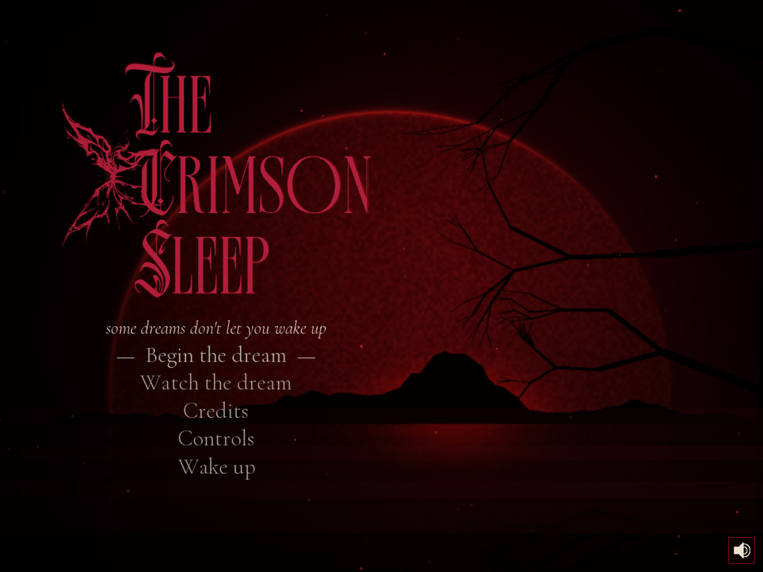
</p>

<h1 align="center">The Crimson Sleep</h1>

<p align="center"><i>some dreams don't let you wake up</i></p>

<p align="center">
A 2D pixel-art horror escape in <b>C++17 + SFML 3</b>. Every mechanic runs on a
<b>hand-written data structure</b>, and a live console lets you watch them change while you play.
</p>

---

On **June 26, 1953**, ten people were murdered in a mansion. The house has slept in crimson ever since.
You wake on its floor. Find the keys, read the clues and survive the dead (Samara, Carrie, the
spirits, the Weavers and the Devil), then choose how the nightmare ends.

### Highlights

- **No STL.** Stack, queue, heap, linked list, BST, graph, tile grid, even the string class: all written by hand in [`src/ds/`](src/ds) and unit-tested.
- **A house that is a graph.** Ten rooms joined by doors. Some doors are locked, a secret passage is found by **DFS**, and when you're stuck a **BFS** route and a trail of blood lead you on.
- **Enemy AI.** Spiders run an **eight-state machine** with **line of sight** and **hearing**, and hunt you with **A\*** and **BFS**.
- **A real boss fight.** You strike with the Blessed Sword and block the Devil's scythe. Hits freeze the frame, and at half health he roars into a faster **second phase**.
- **A live data-structure console.** Press **TAB** and a panel opens beside the game, drawing every structure as the game changes it.
- **Watch the dream.** A self-playing demo finishes the game by the same rules as you, for any of the **four endings**.

---

## Contents

1. [See it](#see-it)
2. [How to play](#how-to-play)
3. [The house](#the-house)
4. [Horrors, and how to survive them](#horrors-and-how-to-survive-them)
5. [The final fight](#the-final-fight)
6. [Endings](#endings)
7. [The data structures](#the-data-structures)
8. [Enemy AI: how the Weavers hunt](#enemy-ai-how-the-weavers-hunt)
9. [Watch the dream](#watch-the-dream)
10. [Build & run](#build--run)
11. [Project layout & tools](#project-layout--tools)
12. [Credits](#credits)

---

## See it

<p align="center">
  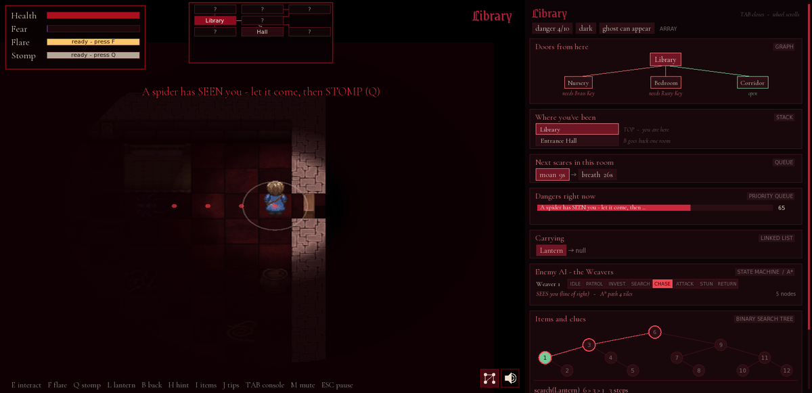<br>
  <sub>The Library with the console open. The graph card shows the room's doors and what opens them, the stack shows where you've been, and the queue shows the next scares.</sub>
</p>

| | |
|---|---|
| 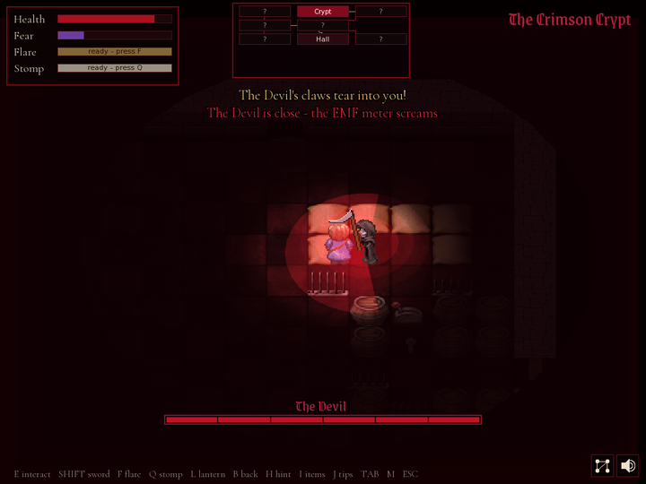<br><sub>The Devil raises his scythe. The white glint on the blade means: block now (C).</sub> | 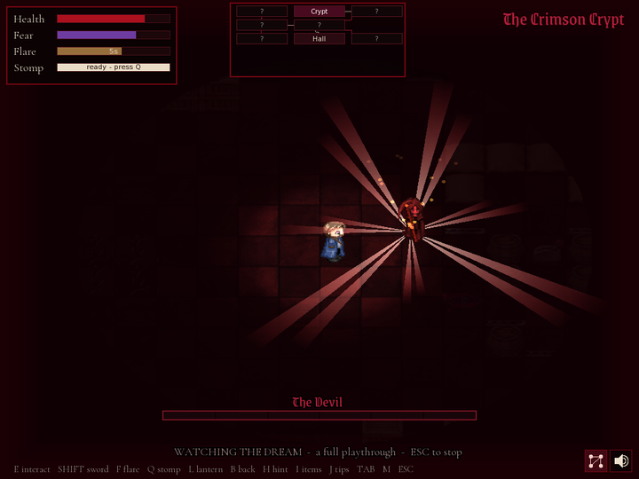<br><sub>Six blows: cracks of light split out of him, and he bursts into ash.</sub> |
| 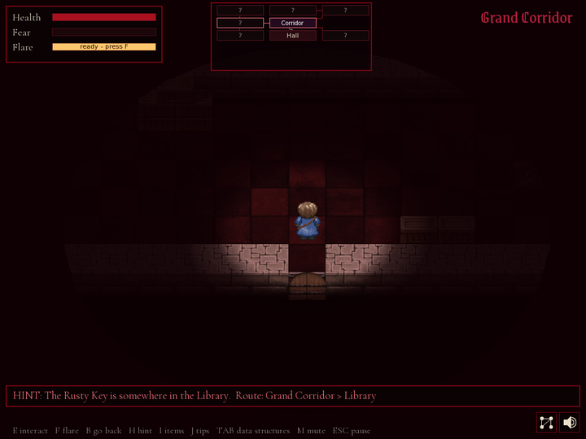<br><sub>Stuck? The hint names the goal and the <b>BFS</b> route to it.</sub> | 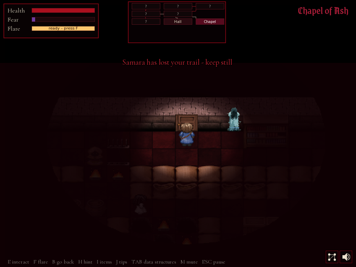<br><sub>Samara hunts by sound. Stand still and she loses your trail.</sub> |
| 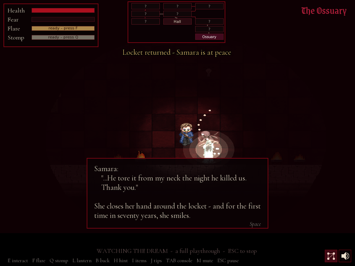<br><sub>Give Samara back her locket and she turns to light.</sub> | 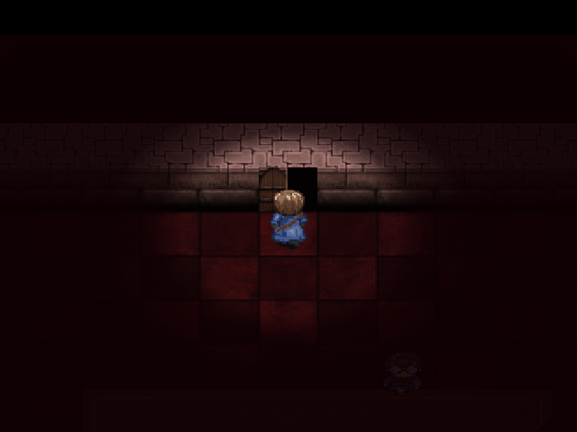<br><sub>Doors swing open on their hinge, and the hero walks through.</sub> |
| 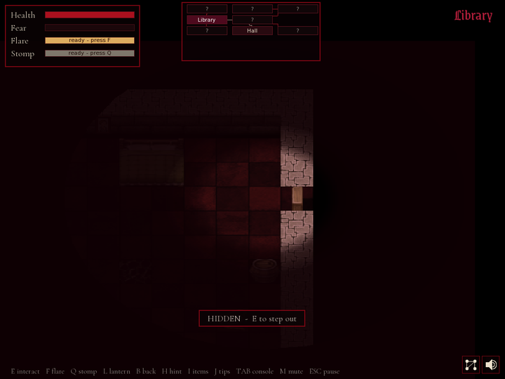<br><sub>Inside a wardrobe, nothing can see, hear or touch you.</sub> | 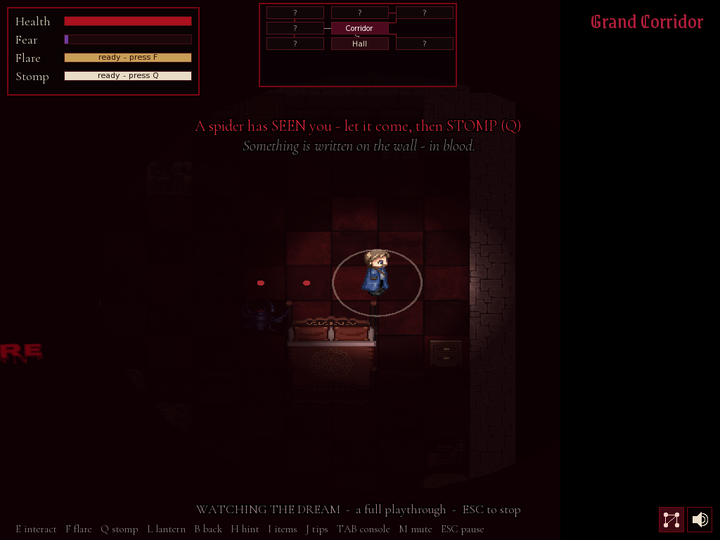<br><sub>A spider at your feet. The ring shows the stomp's reach.</sub> |
| 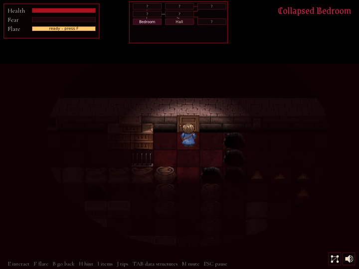<br><sub>The Collapsed Bedroom: pits, fire, spikes and a lever.</sub> | 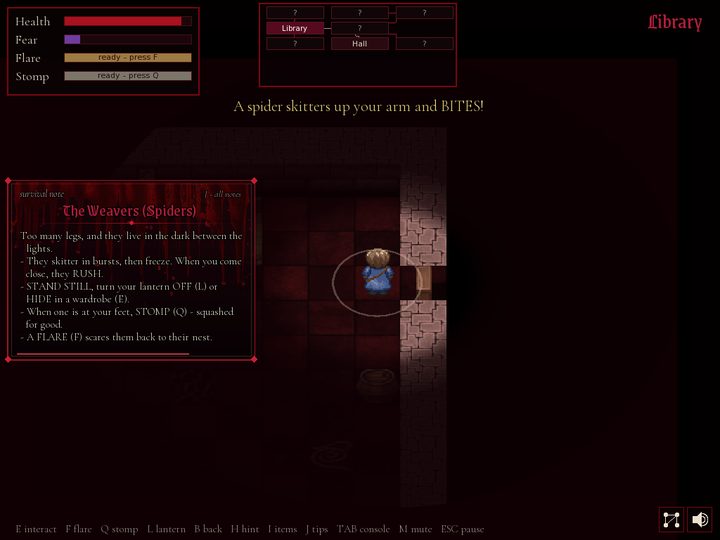<br><sub>Meet a horror and a survival note slides in at the side.</sub> |

---

## How to play

| Key | Action |
|---|---|
| Arrows / WASD | Walk |
| **E** / Enter | Interact: pick up, open, read, use doors, step into / out of a wardrobe |
| **F** | Flare the lantern: stuns and drives back the dead (10 s cooldown) |
| **L** | Lantern on / off. Off, you're harder to see, but your fear rises |
| **Q** | Stomp a spider at your feet (about one tile of reach, 12 s cooldown) |
| **Shift** | Strike with the Blessed Sword (once you have it) |
| **C** (hold) | Block with the sword: face the Devil and raise your guard when his blade glints |
| **B** | Go back one room |
| **H** | Hint: the goal and the route to it |
| **I** / **J** | Inventory / survival notes |
| **TAB** | Open / close the live data-structure console (wheel or PgUp/PgDn scrolls it) |
| **M** | Mute (or click the speaker, bottom-right) |
| **F11** / Alt+Enter | Fullscreen on / off (the game starts in fullscreen) |
| Space | Next line / dismiss text |
| Esc | Pause: Save & quit to menu is here |

**Health** drops when something hurts you; **health kits** hidden in drawers give +40.
**Fear** rises in the dark, near the dead and with every scare. At 100 your mind breaks, so keep
the lantern lit and use flares to steady your nerves. If you die, you wake again in the same room.

The first time you meet each horror, a **survival note** slides in at the side while the game keeps
running (**J** reopens them all). Go 30 seconds without progress and the hint bar names your next
goal, with a trail of blood drops to follow.

**Save & quit** (pause menu) writes `savegame.txt` straight from the data structures, and
**Continue the dream** on the title screen restores the run exactly where you left it.

---

## The house

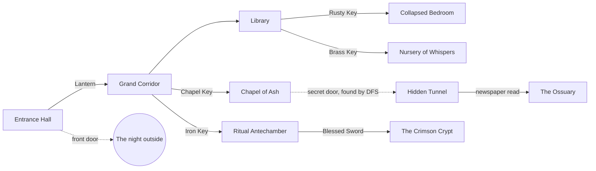

| Room | Danger | Way in | What's there |
|---|---|---|---|
| **Entrance Hall** | 1 | Where you wake | Alfred and the lantern; the front door |
| **Grand Corridor** | 3 | The Lantern | A 1953 newspaper clipping in a drawer |
| **Library** | 4 | Open | The Rusty Key, Alfred's diary |
| **Collapsed Bedroom** | 5 | Rusty Key | A chest with the Brass Key; a lever |
| **Nursery of Whispers** | 7 | Brass Key | The Chapel Key; a lever; Carrie |
| **Chapel of Ash** | 7 | Chapel Key | The Hymn Page, the Iron Key, a lever and an old iron-banded door |
| **Hidden Tunnel** | 8 | Read the Hymn Page (a **DFS** finds the secret door) | The way down |
| **The Ossuary** | 9 | The newspaper clipping, *read* | Samara's bones and her locket |
| **Ritual Antechamber** | 6 | Iron Key | The Blessed Sword, and a can of petrol |
| **The Crimson Crypt** | 10 | The Blessed Sword | The Devil |

This is the exact graph built in [`world.cpp`](src/world.cpp). The **mini-map** at the top of the
screen draws it: unvisited rooms show as `?`, locked doors are dark red, the secret passage stays
invisible until the DFS reveals it, and the hint route glows. Things you take leave the map, and
anything you can still take glints faintly in the dark.

---

## Horrors, and how to survive them

| | Horror | What it does | How to survive |
|---|---|---|---|
| 👻 | **Restless spirits** | Walk the same patrol, over and over | Watch the pattern, then cross. A **flare** freezes them. |
| 🩸 | **Samara** | Drifts through walls, hunting by the sound of your steps | **Stand still**: after about 2.5 silent seconds she loses your trail. A flare banishes her. |
| 🕯️ | **Carrie** | Crawls fast, but only while you aren't looking. She shows faintly in the dark, clearer as she nears | **Face her** and she freezes. A flare drives her away. |
| 🕷️ | **The Weavers** | Spiders that patrol, hear you, see you and chase you, then bite and dart away | Stand still, turn the lantern off or hide in a wardrobe. When one rears up at your feet, **stomp (Q)**. |
| 😈 | **The Devil** | The final boss, waiting in the crypt | See [the final fight](#the-final-fight). |
| 🔥 | **The house** | Spikes, fire and open graves | Time your steps. **Levers** lower the spikes. |

**Samara's locket.** Take the Crimson Locket from her bones in the Ossuary and the weeping stops,
until someone is standing behind you. She rises, comes to you and asks for it. Press **E** and the
locket floats from your hand to hers: she thanks you, turns to light and never hunts you again.
Keep it, and you've chosen a different ending.

---

## The final fight

The Devil sleeps in his grave until you step into the middle of the crypt. Then he rises, with his
own music and a health bar at the bottom of the screen.

- **Strike (Shift).** Six true blows end him. Each one lands with a split-second freeze-frame, a bright cut, embers and a knock-back.
- **Read the scythe.** He raises it and flickers; just before the cut a **white glint** runs along the blade, with a faint *tink*. That's the moment to **hold C facing him**. The blades clash, sparks fly, he staggers, and that's your opening.
- **He fights back.** His attacks vary: a full swing, a quick jab, a double cut and a lunge from further out. After a wound his guard is up for a moment, and hacking at him then gets **parried**.
- **Phase two.** At half health he throws back his head and **roars**. After that his wind-ups are shorter, he moves faster, and he adds a **spinning sweep** that cuts all the way round him. Block that too.
- **A flare** during his wind-up breaks the swing and dazes him. Once he's committed to a swing, though, nothing stops it.

When he falls he convulses, cracks of light split out of him, and he bursts into ash. The dark
lifts, and morning light breaks into the crypt.

---

## Endings

<p align="center">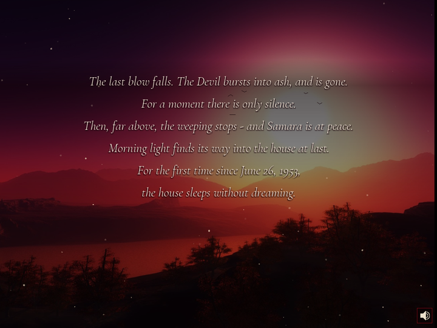</p>

| Ending | How |
|---|---|
| **True** | Slay the Devil **and** give Samara back her locket, **in either order**. If he's already dead when you return it, leave by the front door. |
| **Escape** | Slay the Devil without returning the locket. The crypt's way out opens: walk out of the front door. |
| **Secret** | Keep the locket, leave the Devil asleep, and walk out of the front door with it. |
| **Trapped** | Choose the petrol in the Antechamber. |

Each ending closes with your run stats (time, rooms, items, spirits banished, deaths, peak fear), a
rank and rolling credits over quiet TV static.

---

## The data structures

Every structure lives in [`src/ds/`](src/ds). They are header-only, independent of SFML and
unit-tested by `make test`. Each one does a real job: take it away and a mechanic breaks.

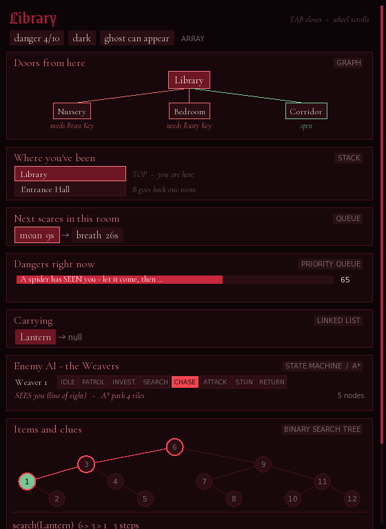

**The live console (TAB).** The window widens and a panel opens beside the game. Each section
*draws* its structure from the live game state:
- keys enter and leave the linked list;
- rooms stack up as you walk;
- the danger heap reorders as something closes in;
- the BST lights up the path a `search()` took.

Click a section to see every element, and click again to fold it. If the screen is too narrow to
widen the window, the game still keeps most of the width.

| Structure | File | What it does in the game |
|---|---|---|
| **Graph** (adjacency list) | [`ds/Graph.h`](src/ds/Graph.h), [`world.cpp`](src/world.cpp) | **The house.** Rooms are nodes and doors are edges. Each edge stores its door, whether it's locked, the item that opens it, and whether it's a hidden passage. |
| **Stack** | [`ds/Stack.h`](src/ds/Stack.h) | **Where you've been.** Entering a room pushes it; **B** pops back to the previous one. |
| **Queue** | [`ds/Queue.h`](src/ds/Queue.h) | **The haunting timeline.** Each room schedules its scares (whispers, slams, cracking floors, blood writing) first-in, first-out. It's also the frontier of every BFS. |
| **Priority queue** (max-heap) | [`ds/PriorityQueue.h`](src/ds/PriorityQueue.h) | **Danger right now.** Every frame each threat goes in with a priority, from Samara's attack (100) and the Devil (90) down to calm (0). The top one drives the warning text, the fear rate and the chase music. It's also A\*'s open set. |
| **Linked list** | [`ds/LinkedList.h`](src/ds/LinkedList.h) | **Inventory.** New items go in at the head, and a key leaves the list when it opens its door. |
| **Binary search tree** | [`ds/BST.h`](src/ds/BST.h) | **Items and clues**, keyed by item id, with *collected* and *read* flags. Puzzle gates query it: the Ossuary opens only once the newspaper has been **read**. |
| **BFS** | [`Graph::bfsPath`](src/ds/Graph.h), [`ai.cpp`](src/ai.cpp) | The hint's room route, the trail of blood, the spiders' escape routes and the demo's walking. |
| **DFS** | [`Graph::dfsExplore`](src/ds/Graph.h) | Reading the Hymn Page runs a DFS over every edge, hidden ones included, which finds the secret door. |
| **A\*** | [`ai.cpp`](src/ai.cpp) | The spiders' chase and investigate paths (Manhattan heuristic, the hand-written heap as the open set). |
| **Array / grid** | [`ds/TileGrid.h`](src/ds/TileGrid.h), `ROOMS[]`, `ITEMS[]` | Room facts (name, map, danger, darkness), item data, and each room's 32×24 tile grid. |
| **String** | [`ds/Str.h`](src/ds/Str.h) | A growable string used instead of `std::string` for all text, names and paths. |

<br clear="right">

<p align="center">
  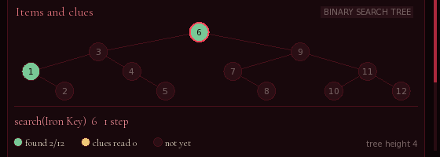<br>
  <sub>Green = collected, gold = clue read. The highlighted path is <code>search(Lantern)</code>: 6 → 3 → 1, three steps.</sub>
</p>

### Complexity

| Operation | Structure | Cost |
|---|---|---|
| push / pop / top | Stack | O(1) |
| enqueue / dequeue | Queue | O(1) |
| insert / extractMax / peek | Priority queue (binary heap) | O(log n) / O(log n) / O(1) |
| insert at head · find / remove | Linked list | O(1) · O(n) |
| search / insert | BST | O(log n) average, O(n) worst |
| BFS / DFS over rooms | Graph | O(V + E) |
| BFS / A\* over a room | 32×24 tile grid | O(W·H) / O(W·H · log(W·H)) |
| tile lookup | Grid | O(1) |

`make test` runs [`tests/ds_tests.cpp`](tests/ds_tests.cpp): 31 checks covering LIFO and FIFO order,
heap order with late high-priority inserts, popping a copy of the heap without touching the
original, list deletion, sorted BST traversal, BFS detouring around a locked door, and DFS finding a
hidden room.

---

## Enemy AI: how the Weavers hunt

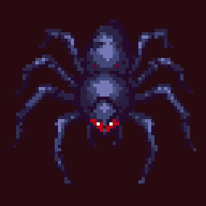

The **Weavers** don't move at random. Each one runs an **eight-state machine** and has two senses:

- **Hearing:** your footsteps carry a few tiles, and a flare can be heard across the room. **Standing still is silent.**
- **Sight:** a **line-of-sight** ray is stepped across the tile grid inside a 120° cone. Walls block it. With your lantern off it only sees you up close; inside a wardrobe it can't sense you at all.

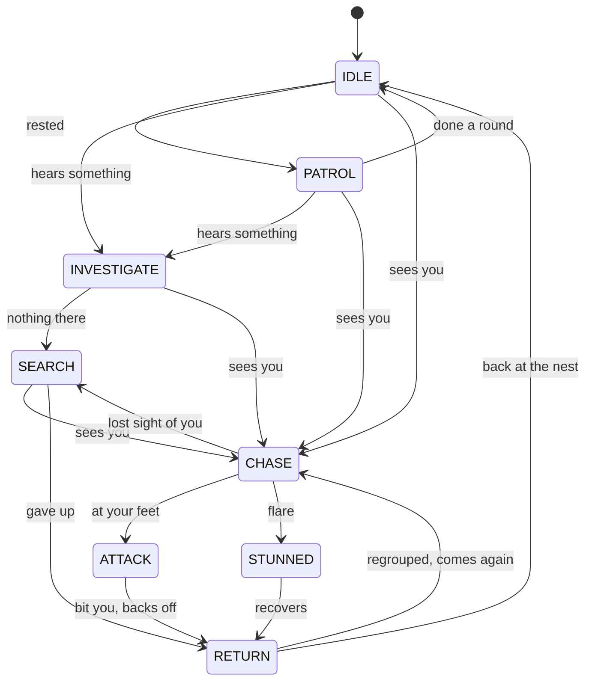

| State | What it does | Algorithm |
|---|---|---|
| IDLE | Still, listening, twitching | — |
| PATROL | Walks between spots around its nest | **BFS** picks the spot, **A\*** walks there |
| INVESTIGATE | Goes to where it heard the sound | **A\*** |
| SEARCH | Looks around where it last saw you | **BFS** + **A\*** |
| CHASE | Re-plans a route to you several times a second | **A\*** |
| ATTACK | Rears up and bites, then backs off a few tiles and comes again | straight line, then **BFS** escape |
| STUNNED | Caught in a flare: curls up | — |
| RETURN | Goes back to its nest | **A\*** |

A spider that is chasing you **follows you through doors**, room after room, until you kill it. When
one rears up at your feet, **stomp (Q)**: the body stays on the floor for good. Once you carry the
sword, **Shift** cuts them down too. In the dark, two red eyes give a spider away before it reaches
the light. With the console open, each spider's planned path is drawn as dots on the floor.

<p align="center">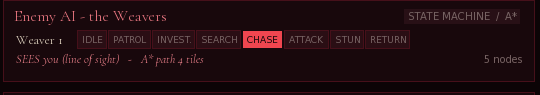</p>

---

## Watch the dream

Pick **Watch the dream** on the title screen and choose an ending: **True**, **Escape**, **Secret**
or **Trapped**. The game plays itself from the first room to that ending at normal speed, by the
same rules as you:
- its health really drops, it searches drawers for kits, and if it dies it wakes again and carries on;
- it walks to each object, faces it and presses **E**, exactly as a player would;
- it finds its way with the project's own BFS, between rooms and across tiles;
- it meets each horror with its survival rule: it faces Carrie, stands still for Samara, flares spirits and stomps spiders;
- it blocks the Devil's scythe, though like a player it is sometimes too slow.

The console is open the whole time (**TAB** hides it), and **Esc** pauses.

<p align="center">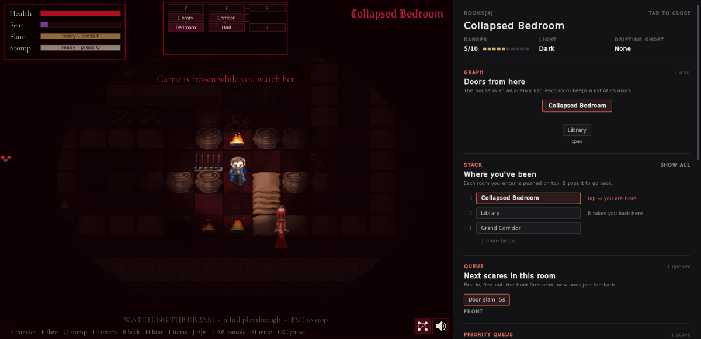</p>

The demo doubles as the game's end-to-end test: if a room couldn't be solved, the demo would get stuck.

---

## Build & run

You need **SFML 3** (Graphics, Window, System, Audio) and a C++17 compiler.

**The easy way: the launchers.** Each one builds what changed (so a `git pull` is picked up) and starts the game.

| System | Launcher |
|---|---|
| Linux | `./run.sh` |
| macOS | `./run.sh`, or double-click **`run.command`** in Finder |
| Windows | double-click **`run.bat`** (needs MSYS2 in `C:\msys64`) |

`run.sh` finds SFML 3 by itself (Homebrew on macOS, the system install on Linux) and tells you what
to install if it's missing. `./run.sh --rebuild` does a clean build, and
`SFML_DIR=/path/to/sfml3 ./run.sh` uses an SFML 3 install in a custom place.

**By hand**

```bash
# Linux (Ubuntu / Debian)
sudo apt-get install -y g++ make libsfml-dev   # must be SFML 3.x
make            # builds ./crimson_sleep
make run        # starts it (run from this folder: it loads ./assets)
make test       # unit tests for every data structure
```

- **macOS:** `brew install sfml`, then `make SFML_DIR=$(brew --prefix sfml)`.
- **Windows (MSYS2):** `pacman -S mingw-w64-x86_64-gcc mingw-w64-x86_64-sfml make`, then `make` in the MinGW shell.
- **Windows (Visual Studio):** `cmake -B build -DSFML_DIR="C:/SFML/lib/cmake/SFML"`, then `cmake --build build --config Release`.

The game opens in **fullscreen**; **F11** (or Alt+Enter) switches to a window and back.
Set `CRIMSON_WINDOWED=1` to start in a window.

If the sound output changes while you play (say you unplug your earphones), the game moves its
sound to the new output within a couple of seconds.

---

## Project layout & tools

```
src/            game code: SFML layer and game logic
src/ds/         the hand-written data structures (header-only, no STL)
src/ai.cpp      enemy AI toolkit: A*, BFS escape/search, line of sight
src/demo.cpp    "Watch the dream", the self-playing demo
tests/          data-structure unit tests
assets/         maps, sprites, music, fonts
tools/          Python scripts that generate art, sprites, sounds and music
docs/images/    the screenshots in this README
```

**Generated assets.** Much of the art and sound is built by scripts in [`tools/`](tools) (Python 3 with Pillow, and numpy for audio):

| Script | Makes |
|---|---|
| `make_spider.py` | The spider walk cycle: each leg cut out (a multi-source BFS decides which pixel belongs to which leg) and swung around its joint |
| `make_sword_attack.py`, `make_block.py`, `make_stomp.py` | The hero's sword swing, guard and stomp, in four directions |
| `make_devil_attack.py` | The Devil's scythe swing: the scythe redrawn around his hands in four poses and four directions |
| `make_boss_music.py` | The fight music: war drums, a minor-key ostinato, a dark choir and anvil hits, as a seamless loop |
| `make_combat_sfx.py` | Clangs, sword and scythe sounds, the stomp's squish and the Devil's death music |
| `make_secret_door.py`, `make_empty_table.py`, `make_wardrobe.py`, `make_drawer.py` | Furniture and the Chapel's secret door |
| `make_art.py`, `make_maps.py`, `place_furniture.py` | The crimson tileset, ghosts, and the Tunnel and Ossuary maps |
| `make_logo.py`, `make_blood_decals.py`, `make_blood_drip.py`, `make_fire.py` | The title logo, blood decals and drips, and brazier fire |

**Headless screenshots.** The game takes a few environment variables for testing:

```bash
CS_STATE=title CS_FRAMES=240 CS_SHOT=title.png ./crimson_sleep
CS_ROOM=3 CS_CONSOLE=1 CS_SPIDER=1 CS_FRAMES=24 CS_SHOT=console.png ./crimson_sleep
```

| Variable | Effect |
|---|---|
| `CS_ROOM=n` | Start in room *n* |
| `CS_CONSOLE=1` | Open the console |
| `CS_DEMO=1`..`4` | Run the demo of the True / Escape / Secret / Trapped ending |
| `CS_BRIDE=1`, `CS_SPIDER=1` | Spawn a horror next to you |
| `CS_LOCKET=1` / `2` | Start carrying the locket / having already returned it |
| `CS_STATE=ending_4` | Show an ending screen |
| `CS_SEED=n` | Make a run repeatable |
| `CS_FRAMES=n`, `CS_SHOT=file.png` | Save a screenshot after *n* frames and quit |

---

## Credits

**Made by Nishita, Yashieta, Anwita and Aryan.**

- **Pixel art & sprites:** retro horror pixel sprites, the team's hero, ghost and spider art, and custom walk and attack animations.
- **Music:** *Title Music* (title screen); *Ambient Horror* by Alex Morgan (calm rooms); a music-box lullaby (the Nursery); *Creep* (dangerous rooms); *Chase* (when something hunts you); the fight music and the Devil's death music (made with `tools/`); *Wrong* (death screen and the Trapped ending); *Apartments* (True ending); *Moonlit Lullaby for the Lost* (Escape and Secret endings).
- **Sound:** room ambiences and effects from the team's sound library (converted by `tools/make_audio.py`), plus Pixabay effects: *scream* and *scary breath* (freesound_community), *scary loud screaming* (judgecruz1 / remusic), *scary bells* (Dragon Studio), *scary sound effect* (hgoliya08).
- **Fonts:** Grenze Gotisch, Cormorant Garamond and Nosifer (SIL Open Font License, `assets/fonts/OFL.txt`), and DejaVu Sans.
